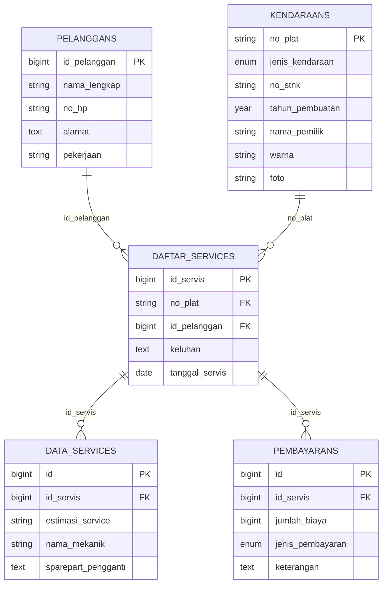

# YZ Service Motor — Sistem Manajemen Bengkel

Aplikasi web untuk mengelola operasional bengkel motor: data pelanggan, kendaraan, antrean servis, rincian pengerjaan, hingga pembayaran. Dibangun dengan **Laravel**, tampilan **Bootstrap 5** bertema gelap, dan dilengkapi **REST API** (Laravel Sanctum) untuk diuji lewat Postman.

---

## Fitur

### Modul utama
| Modul | Fungsi |
|---|---|
| **Pelanggan** | Data pemilik motor (nama, no HP, alamat, pekerjaan) |
| **Kendaraan** | Data unit berdasarkan no plat, jenis (Matic / Manual Transmisi), no STNK, tahun, warna, dan foto |
| **Daftar Service** | Pencatatan servis masuk: kendaraan, pelanggan, keluhan, tanggal |
| **Data Service** | Rincian pengerjaan: estimasi waktu, nama mekanik, sparepart yang diganti |
| **Pembayaran** | Biaya servis dengan metode Cash / Tunai atau Non Tunai |
| **Dashboard** | Ringkasan jumlah data, servis masuk terbaru, dan pelanggan terbaru |

### Hak akses (role)
- **admin** — melihat, menambah, mengubah, dan menghapus semua data.
- **petugas** (role bawaan akun baru) — hanya dapat **melihat** data.

### Autentikasi
Login, registrasi, lupa/reset password, konfirmasi password, dan verifikasi email (berbasis Laravel Breeze), serta halaman profil.

### Pengalaman pengguna (UI/UX)
- Tema gelap responsif dengan sidebar yang bisa dilipat
- Animasi halus: transisi halaman, hitung naik pada angka dashboard, efek kartu, kursor kustom
- **Command palette** (`Ctrl/⌘ + K`) untuk berpindah menu cepat
- Tabel dengan pencarian (sorotan kata), pengurutan kolom, dan penghitung hasil; tekan `/` untuk fokus ke kolom cari
- Modal konfirmasi hapus, pratinjau foto sebelum upload, indikator kekuatan password
- Menghormati pengaturan *reduced motion* dan otomatis menonaktifkan kursor kustom di layar sentuh

---

## Teknologi

- PHP & **Laravel** (struktur Laravel 11+)
- **Laravel Sanctum** — autentikasi token untuk API
- **Laravel Breeze** — autentikasi web
- **Bootstrap 5.3** (CDN) + CSS/JS kustom (`public/css`, `public/js`)
- **SQLite** (bawaan, bisa diganti MySQL/PostgreSQL lewat `.env`)

---

## Struktur Basis Data



Semua relasi memakai `cascadeOnUpdate` dan `cascadeOnDelete`: menghapus kendaraan atau pelanggan juga menghapus servis terkait beserta rincian dan pembayarannya.

---

## Instalasi

### Prasyarat
- PHP 8.2+ dan Composer
- Ekstensi PHP: `pdo_sqlite` (atau driver database pilihanmu), `mbstring`, `fileinfo`, `gd`/`imagick` (untuk upload gambar)
- Node.js (opsional, hanya jika ingin build aset Vite)

### Langkah

```bash
# 1. Clone repositori
git clone https://github.com/yaniss-sudo/NAMA-REPO.git
cd NAMA-REPO

# 2. Pasang dependensi
composer install

# 3. Siapkan environment
cp .env.example .env
php artisan key:generate

# 4. Siapkan database (SQLite)
touch database/database.sqlite      # Windows: type nul > database\database.sqlite
php artisan migrate --seed

# 5. Tautkan folder storage (agar foto kendaraan tampil)
php artisan storage:link

# 6. Jalankan
php artisan serve
```

Buka **http://localhost:8000**.

> Tampilan memakai berkas statis di `public/css` dan `public/js`, jadi `npm run build` **tidak wajib** untuk halaman utama.

### Akun bawaan (hasil seeder)

| Email | Password | Role |
|---|---|---|
| `admin@service.test` | `admin12345` | admin |

> ⚠️ **Segera ganti password bawaan ini** sebelum aplikasi dipakai atau di-deploy ke server publik.

Akun yang dibuat lewat halaman **Daftar** otomatis berole `petugas`. Untuk menjadikannya admin, ubah kolom `role` di tabel `users` menjadi `admin`.

---

## REST API

Base URL (lokal): `http://127.0.0.1:8000/api`

API memakai **Laravel Sanctum** (Bearer token) dan mengembalikan JSON. Hak aksesnya sama dengan aplikasi web: semua user login boleh **membaca**, hanya **admin** yang boleh **menambah, mengubah, dan menghapus**.

### Header wajib

```http
Accept: application/json
Authorization: Bearer <token>
```

> **Penting:** selalu kirim `Accept: application/json`. Tanpa header ini, error validasi dan error login akan berupa *redirect* ke halaman web, bukan JSON.

### Format response

| Situasi | Bentuk response |
|---|---|
| Berhasil (data) | `{ "success": true, "data": ... }` |
| Berhasil (hapus/logout) | `{ "success": true, "message": "..." }` |
| Data tidak ditemukan | `404` → `{ "success": false, "message": "Data tidak ditemukan" }` |
| Login salah | `401` → `{ "success": false, "message": "Email atau password salah" }` |
| Token tidak ada/salah | `401` → `{ "message": "Unauthenticated." }` |
| Bukan admin | `403` → `{ "message": "Hanya admin yang boleh mengakses." }` |
| Validasi gagal | `422` → `{ "message": "...", "errors": { "field": ["..."] } }` |
| Terlalu banyak login | `429 Too Many Requests` |

Kode status sukses: `200` (baca/ubah/hapus) dan `201` (data baru dibuat).

---

### 1. Autentikasi

| Method | Endpoint | Auth | Keterangan |
|---|---|---|---|
| POST | `/login` | – | Login dan ambil token (**maks. 5 percobaan per menit**) |
| GET | `/me` | Token | Data user yang sedang login |
| POST | `/logout` | Token | Mencabut token yang sedang dipakai |

**Login**

```bash
curl -X POST http://127.0.0.1:8000/api/login \
  -H "Accept: application/json" \
  -H "Content-Type: application/json" \
  -d '{"email":"admin@service.test","password":"admin12345"}'
```

```json
{
  "success": true,
  "token": "1|abcdefghijklmnopqrstuvwxyz...",
  "user": { "name": "Admin", "email": "admin@service.test", "role": "admin" }
}
```

Simpan nilai `token`, lalu pakai sebagai `Authorization: Bearer <token>` pada request berikutnya.

**Me**

```bash
curl http://127.0.0.1:8000/api/me \
  -H "Accept: application/json" -H "Authorization: Bearer <token>"
```
```json
{ "success": true, "data": { "name": "Admin", "email": "admin@service.test", "role": "admin" } }
```

---

### 2. Daftar endpoint resource

Pola yang sama berlaku untuk kelima resource: `pelanggan`, `kendaraan`, `daftar-service`, `data-service`, `pembayaran`.

| Method | Endpoint | Akses | Keterangan |
|---|---|---|---|
| GET | `/{resource}` | Semua user login | Daftar data (terbaru dulu) |
| GET | `/{resource}/{id}` | Semua user login | Detail satu data |
| POST | `/{resource}` | **Admin** | Tambah data → `201` |
| PUT / PATCH | `/{resource}/{id}` | **Admin** | Ubah data |
| DELETE | `/{resource}/{id}` | **Admin** | Hapus data |

Nilai `{id}` tiap resource:

| Resource | `{id}` |
|---|---|
| `pelanggan` | `id_pelanggan` (angka) |
| `kendaraan` | `no_plat` (teks, mis. `BK 1234 AB`; spasi ditulis `%20` di URL) |
| `daftar-service` | `id_servis` (angka) |
| `data-service` | `id` (angka) |
| `pembayaran` | `id` (angka) |

> Update memakai validasi yang sama dengan tambah data, jadi **semua field wajib dikirim ulang** (kecuali yang `nullable`), termasuk saat memakai `PATCH`.

---

### 3. Field dan aturan validasi

#### Pelanggan — `/api/pelanggan`

| Field | Aturan |
|---|---|
| `nama_lengkap` | wajib, teks, maks. 100 |
| `no_hp` | wajib, 8–20 karakter berisi angka, `+`, `-`, atau spasi |
| `alamat` | wajib, teks |
| `pekerjaan` | wajib, teks, maks. 100 |

#### Kendaraan — `/api/kendaraan`

| Field | Aturan |
|---|---|
| `no_plat` | wajib saat **tambah**, unik, maks. 15 (primary key, **tidak bisa diubah** saat update) |
| `jenis_kendaraan` | wajib, salah satu: `Matic` atau `Manual Transmisi` |
| `no_stnk` | wajib, teks, maks. 50 |
| `tahun_pembuatan` | wajib, angka antara `1980` dan tahun berjalan |
| `nama_pemilik` | wajib, teks, maks. 100 |
| `warna` | wajib, teks, maks. 50 |
| `foto` | opsional, gambar `jpg/jpeg/png/webp`, maks. 2 MB |

Response kendaraan otomatis menyertakan `foto_url` (URL lengkap foto, atau `null`). Agar URL bisa dibuka, jalankan `php artisan storage:link`.

#### Daftar Service — `/api/daftar-service`

| Field | Aturan |
|---|---|
| `no_plat` | wajib, harus ada di tabel kendaraan |
| `id_pelanggan` | wajib, harus ada di tabel pelanggan |
| `keluhan` | wajib, teks |
| `tanggal_servis` | wajib, tanggal valid (`YYYY-MM-DD`) |

Response menyertakan relasi `pelanggan` dan `kendaraan`.

#### Data Service — `/api/data-service`

| Field | Aturan |
|---|---|
| `id_servis` | wajib, harus ada di tabel daftar-service |
| `estimasi_service` | wajib, teks, maks. 100 (mis. `2 jam`) |
| `nama_mekanik` | wajib, teks, maks. 100 |
| `sparepart_pengganti` | opsional, teks |

Response menyertakan relasi `daftarService`.

#### Pembayaran — `/api/pembayaran`

| Field | Aturan |
|---|---|
| `id_servis` | wajib, harus ada di tabel daftar-service |
| `jumlah_biaya` | wajib, bilangan bulat ≥ 0 (rupiah, tanpa titik/koma) |
| `jenis_pembayaran` | wajib, salah satu: `Cash / Tunai` atau `Non Tunai` |
| `keterangan` | opsional, teks |

Response menyertakan relasi `daftarService`.

---

### 4. Contoh pemakaian

**Tambah pelanggan** (admin)

```bash
curl -X POST http://127.0.0.1:8000/api/pelanggan \
  -H "Accept: application/json" -H "Authorization: Bearer <token>" \
  -H "Content-Type: application/json" \
  -d '{"nama_lengkap":"Budi Santoso","no_hp":"081234567890","alamat":"Jl. Merdeka No. 10, Medan","pekerjaan":"Wiraswasta"}'
```
```json
{
  "success": true,
  "data": {
    "nama_lengkap": "Budi Santoso",
    "no_hp": "081234567890",
    "alamat": "Jl. Merdeka No. 10, Medan",
    "pekerjaan": "Wiraswasta",
    "updated_at": "2026-11-19T08:00:00.000000Z",
    "created_at": "2026-11-19T08:00:00.000000Z",
    "id_pelanggan": 1
  }
}
```

**Tambah kendaraan dengan foto** (harus `multipart/form-data`, bukan JSON)

```bash
curl -X POST http://127.0.0.1:8000/api/kendaraan \
  -H "Accept: application/json" -H "Authorization: Bearer <token>" \
  -F "no_plat=BK 1234 AB" \
  -F "jenis_kendaraan=Matic" \
  -F "no_stnk=STNK-998877" \
  -F "tahun_pembuatan=2022" \
  -F "nama_pemilik=Budi Santoso" \
  -F "warna=Hitam" \
  -F "foto=@/path/ke/motor.jpg"
```

**Ubah kendaraan dengan foto baru** — PHP tidak membaca file dari request `PUT` bertipe multipart, jadi kirim sebagai `POST` dengan field `_method=PUT`:

```bash
curl -X POST "http://127.0.0.1:8000/api/kendaraan/BK%201234%20AB" \
  -H "Accept: application/json" -H "Authorization: Bearer <token>" \
  -F "_method=PUT" \
  -F "jenis_kendaraan=Matic" -F "no_stnk=STNK-998877" -F "tahun_pembuatan=2022" \
  -F "nama_pemilik=Budi Santoso" -F "warna=Merah" \
  -F "foto=@/path/ke/motor-baru.jpg"
```

Foto lama otomatis dihapus dari storage saat foto baru diunggah, dan saat data kendaraan dihapus.

**Daftarkan servis**

```bash
curl -X POST http://127.0.0.1:8000/api/daftar-service \
  -H "Accept: application/json" -H "Authorization: Bearer <token>" \
  -H "Content-Type: application/json" \
  -d '{"no_plat":"BK 1234 AB","id_pelanggan":1,"keluhan":"Rem depan blong","tanggal_servis":"2026-11-19"}'
```
```json
{
  "success": true,
  "data": {
    "id_servis": 1,
    "no_plat": "BK 1234 AB",
    "id_pelanggan": 1,
    "keluhan": "Rem depan blong",
    "tanggal_servis": "2026-11-19",
    "pelanggan": { "id_pelanggan": 1, "nama_lengkap": "Budi Santoso" },
    "kendaraan": { "no_plat": "BK 1234 AB", "jenis_kendaraan": "Matic" }
  }
}
```

> Isi response di atas diringkas; field `created_at`/`updated_at` dan atribut relasi lain ikut dikembalikan.

**Catat pembayaran**

```bash
curl -X POST http://127.0.0.1:8000/api/pembayaran \
  -H "Accept: application/json" -H "Authorization: Bearer <token>" \
  -H "Content-Type: application/json" \
  -d '{"id_servis":1,"jumlah_biaya":150000,"jenis_pembayaran":"Cash / Tunai","keterangan":"Ganti kampas rem"}'
```

**Contoh error validasi (`422`)**

```json
{
  "message": "The no hp field format is invalid.",
  "errors": { "no_hp": ["The no hp field format is invalid."] }
}
```

**Contoh akses ditolak (`403`)** — user `petugas` mencoba menulis data:

```json
{ "message": "Hanya admin yang boleh mengakses." }
```

---

### 5. Pengujian dengan Postman

Koleksi ada di [`Postman/New Collection.postman_collection.json`](Postman/New%20Collection.postman_collection.json) (basis URL `http://127.0.0.1:8000`). Isinya saat ini baru mencakup **login** dan **CRUD pelanggan**; resource lain bisa dibuat dengan pola yang sama.

Langkah singkat:

1. **Import** file koleksi ke Postman.
2. Jalankan `POST /api/login`, salin nilai `token`.
3. Pada tab **Authorization** tiap request pilih **Bearer Token** dan tempel token (atau set di level koleksi agar berlaku untuk semua request).
4. Tambahkan header `Accept: application/json`.
5. Untuk upload foto kendaraan, pilih **Body → form-data**, ubah tipe field `foto` menjadi **File**. Untuk update, kirim `POST` dengan field `_method` bernilai `PUT`.

## Struktur Folder Penting

```
app/
├── Http/Controllers/          # Controller web (CRUD per modul)
│   └── Api/                   # Controller REST API
├── Http/Middleware/AdminMiddleware.php
└── Models/                    # Pelanggan, Kendaraan, DaftarService, DataService, Pembayaran, User
database/
├── migrations/
└── seeders/DatabaseSeeder.php # Membuat akun admin
public/
├── css/main.css               # Gaya dasar
├── css/ui-enhance.css         # Lapisan animasi & efek tambahan
└── js/ui-enhance.js           # Kursor, command palette, tabel pintar, dll.
resources/views/               # Blade: layouts, auth, dashboard, dan tiap modul
routes/
├── web.php                    # Route halaman web
├── api.php                    # Route REST API
└── auth.php                   # Route autentikasi
Postman/                       # Koleksi pengujian API
tests/                         # Pengujian fitur (autentikasi & profil)
```

---

## Pengujian

```bash
php artisan test
```

---

## Catatan Pengembangan

- Menghapus `public/css/ui-enhance.css` dan `public/js/ui-enhance.js` serta tautannya di layout mengembalikan tampilan ke versi sederhana tanpa animasi tambahan; fungsi aplikasi tidak berubah.
- Gambar latar di `public/images` cukup besar (1–3 MB). Mengompresnya (misalnya ke WebP) akan mempercepat pemuatan halaman.
- File `.env`, `database/database.sqlite` berisi data asli, dan `vendor/` sebaiknya tidak ikut di-commit.

---

## Lisensi

Proyek ini dibuat untuk keperluan pembelajaran dan pengembangan. Tentukan lisensi sesuai kebutuhanmu (misalnya MIT) sebelum dipublikasikan.
